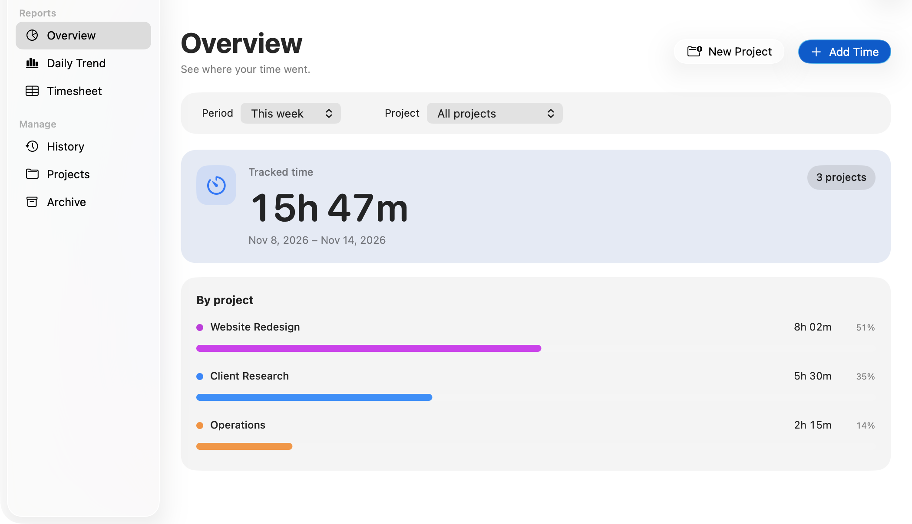
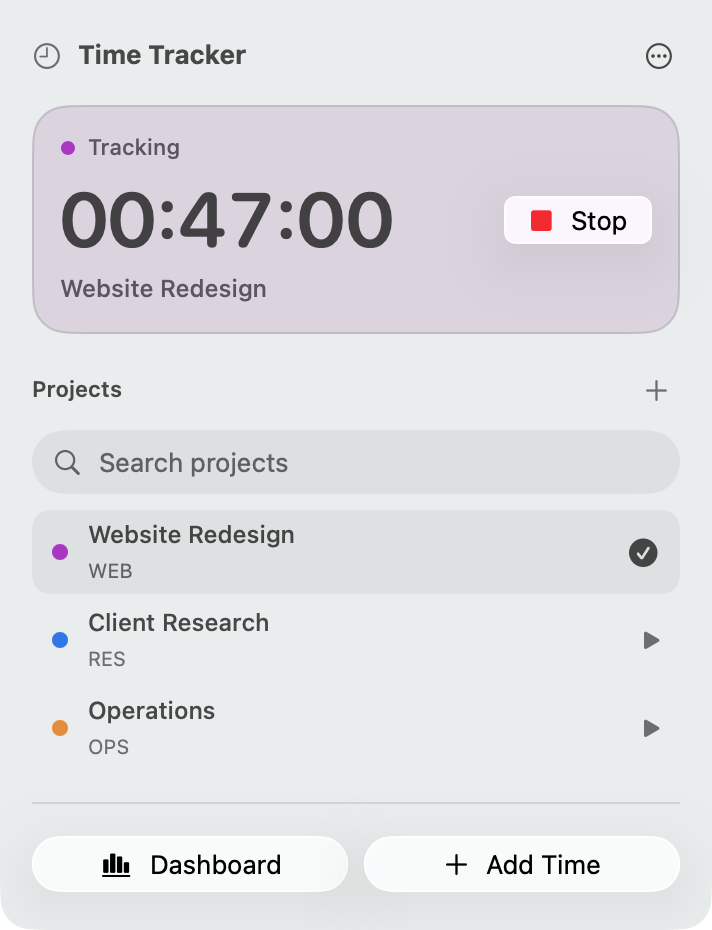

# Time Tracker

Track project time from your Mac’s menu bar. See where it went in the dashboard.



## Install

Requires macOS 14 or later on Apple silicon or Intel. [Download the ZIP](https://github.com/a-bekheet/time-tracker/releases/latest) and move **Time Tracker.app** to Applications, or install with Homebrew:

```sh
brew install --cask a-bekheet/tap/time-tracker
```

The release build is ad hoc signed and unnotarized. If macOS blocks the downloaded app, see [Apple's instructions for opening an app from an unidentified developer](https://support.apple.com/guide/mac-help/open-a-mac-app-from-an-unidentified-developer-mh40616/mac). You can also build the app locally using the instructions below.

## Use

Click the clock in the menu bar to start, switch, or stop timers. Open **Dashboard** for reports, history, manual entries, and CSV export. Data stays on your Mac at `~/Library/Application Support/TimeTracker/data.json`.



## Build

With the macOS Swift command-line tools installed, run `./build-app.sh` from this directory. It produces `Time Tracker.app` here. Use `./build-app.sh --universal` to include both Apple silicon and Intel builds in one app bundle.

After rebuilding, quit any running copy of Time Tracker and open the rebuilt app from this folder. macOS keeps the old interface running until the app quits. Check **Time Tracker → About Time Tracker** for the version number.

To run the core checks without Xcode or XCTest:

```sh
mkdir -p /tmp/timetracker-swift-cache
CLANG_MODULE_CACHE_PATH=/tmp/timetracker-swift-cache swiftc -parse-as-library Sources/TimeTracker/Models.swift Sources/TimeTracker/Store.swift checks/CoreChecks.swift -o /tmp/timetracker-core-checks
/tmp/timetracker-core-checks
```
